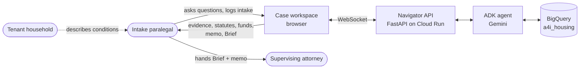
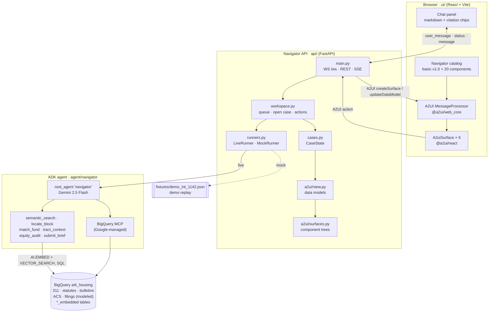
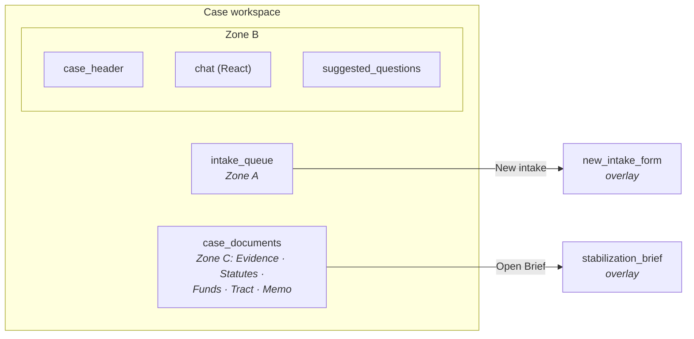
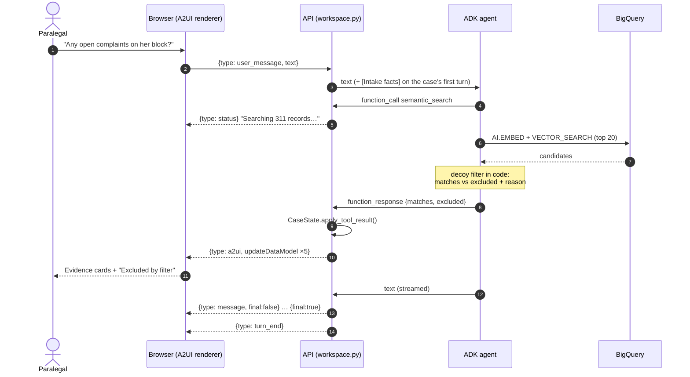
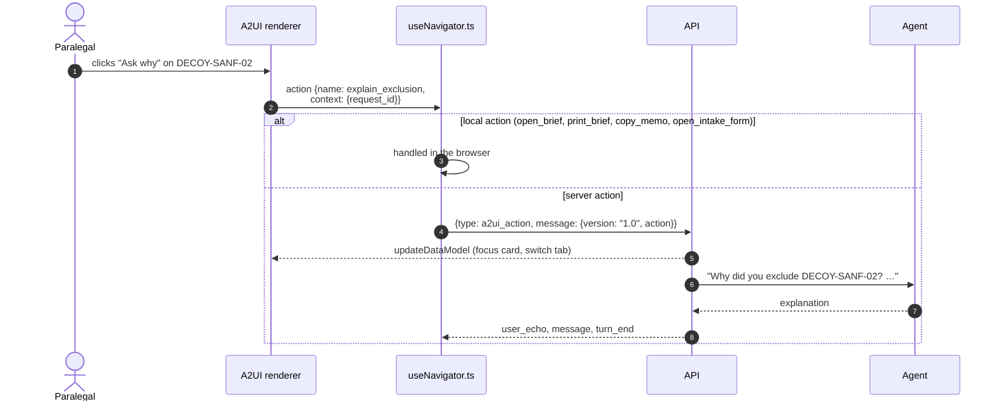
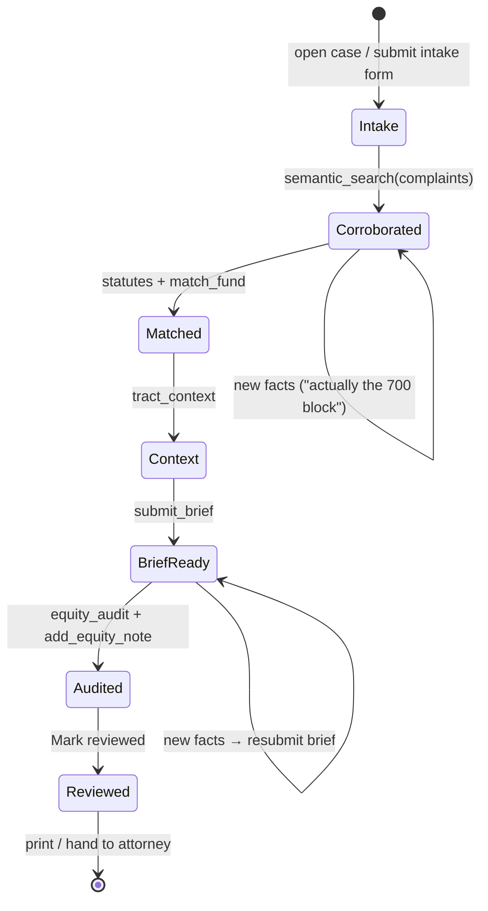
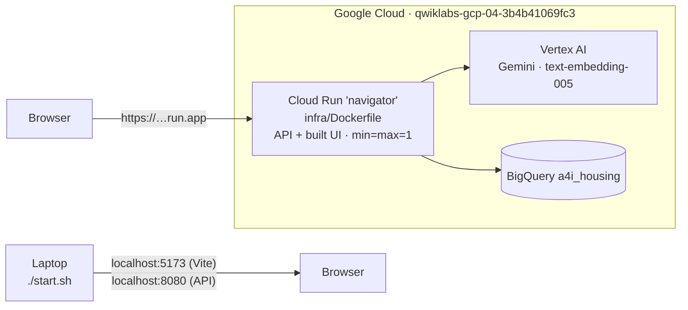

# Stabilization Navigator: A2UI architecture, users and how to use it

**Covers:** the case workspace (`ui/`), the API (`api/`) and how they drive the ADK agent (`agent/`)
**Related:** [`ARCHITECTURE.md`](ARCHITECTURE.md) (agent, tools, decoy filter) · [`UI_API.md`](UI_API.md) (endpoint reference) · [`AGENT_REQUIREMENTS.md`](AGENT_REQUIREMENTS.md) (what the agent must return)

---

## 1. What it is

A legal-aid **intake paralegal** has a tenant across the desk and a nonpayment hearing days away. In one screen they talk to an AI agent that:

1. finds **open residential 311 habitability complaints** on the tenant's block with BigQuery Vector Search,
2. **throws out look-alikes** (commercial, closed, "no violation") and shows why,
3. matches the **statutes** and **emergency funds** that apply,
4. adds **neighborhood context** (rent burden, modeled eviction filings),
5. drafts an **intake memo** and a printable **Tenant Stabilization Brief** for the supervising attorney.

The screen is built with Google's **A2UI** (Agent-to-User Interface) protocol. The server describes each panel as JSON (components + data); the browser renders it with the official A2UI React renderer.

---

## 2. Who uses it

| User | What they need | Where they look |
|---|---|---|
| **Intake paralegal** (primary) | Fast answers with record ids to cite; what to do before the hearing; 15–20 minutes per family | Chat, Evidence / Statutes / Funds tabs, suggested questions |
| **Supervising housing attorney** | A clean packet: citations, caveats, fund referrals, signed review | The Brief (print / PDF), the Memo tab |
| **Tenant household** (in the room, not a user) | Nothing on screen that exposes them | Only initials and the 100-block are ever shown; no race data outside the Brief's equity audit |
| **Hackathon judges** | Proof the agent catches decoys and says what the data can't prove | "Excluded by filter" drawer, modeled-data tags, "cannot prove" box |



---

## 3. System architecture



### The key design decision

**The agent never writes UI.** It calls tools and writes text. The API folds every tool result into a `CaseState`, turns that into a data model per surface, and sends it to fixed component trees. So the panel can only ever show a record a tool actually returned: a hallucinated or decoy record has no path to the screen.

| Layer | Owns | Never does |
|---|---|---|
| Agent | Which tools to call, the wording of answers and the memo | Emit A2UI, decide fund eligibility (code does), rank with `audit_*` data |
| API | Case state, formatting, tones, which tab is open, A2UI messages | Call the model for UI, invent fields |
| UI | Rendering, local actions (open Brief, print, copy) | Interpret raw tool output |

### The six A2UI surfaces



---

## 4. How a chat turn flows



## 5. How a button click flows (A2UI action)



| Action | Sent by | Result |
|---|---|---|
| `ask {text}` | suggested-question chips, memo Regenerate | agent turn |
| `explain_exclusion {request_id}` | Ask why | highlight + agent turn |
| `focus_record {request_id}` | citation chip in chat | open tab, highlight card |
| `open_case {case_id}` | queue | switch case and ADK session |
| `submit_intake {…}` | New intake form | new case + first search |
| `mark_memo_reviewed` | Memo tab | memo status → Reviewed |

## 6. Case lifecycle



The five chips in the case header (Intake · Corroborate 311 · Statute & fund match · Tract & equity check · Memo for attorney) follow these states.

## 7. Deployment



One container serves both the API and the built UI. `max-instances=1` because ADK sessions and workspaces are in memory.

---

## 8. How to use it

### Start and stop

```bash
cd ui && npm install && cd ..   # once
./start.sh            # demo mode: no Google Cloud needed, replays case INT-1142
./start.sh live       # real agent: run `gcloud auth application-default login` first
./stop.sh
```

Open **http://localhost:5173**. Demo mode shows an orange **Demo replay · not live BigQuery** tag in the top bar.

### A 20-minute intake, step by step

| # | Do this | You'll see |
|---|---|---|
| 1 | Pick the case in **Today's intake** (left), or click **New intake** and fill initials, block, the issue in the tenant's words, hearing date and notice. Never type full names or unit numbers. | Case header with hearing countdown (red when the hearing is within 7 days) |
| 2 | Ask *"Any open residential complaints on her block?"* (or click the suggestion) | Tool-trace lines in chat; **Evidence** tab fills; records on her block are tagged **Same block** |
| 3 | Open **Excluded by filter** and click **Ask why** on a record | The failing field (`property_type = Commercial`, `closed_date = …`) and the agent's explanation |
| 4 | Ask *"Which statute bars the rent demand?"* | **Statutes** tab, each with a **Needs:** line saying what is still missing (for example a citation on her unit) |
| 5 | Ask *"Which fund fits before Monday?"* | **Funds** tab: Likely fit / Conditional / Needs income, with why and the intake link |
| 6 | Ask *"How bad is eviction pressure here?"* | **Tract** tab; filing numbers carry the violet **modeled** tag |
| 7 | Ask *"Draft the intake memo"* | **Memo** tab; review it, then **Mark reviewed** |
| 8 | Click **Open Tenant Stabilization Brief →** | The printable Brief: evidence, exclusions, statutes, funds, tract, equity audit, what the record cannot prove, memo. **Print / save as PDF** for the attorney. |

Click any record id in the chat (blue chip, or orange for an excluded decoy) to jump to it in the panel. New facts mid-conversation ("actually it's the 700 block", "hearing moved to Thursday") re-run the affected searches, and changed cards are tagged **Updated**.

### What the screen will never claim

- A 311 record shows conditions **on the block**, not in her unit. The boundary note stays under the evidence and in the Brief.
- Eviction filing counts are **modeled** neighborhood baselines, not her court docket.
- Fund eligibility comes from rules in code, not the model's judgment.
- Demographic (`audit_*`) data appears only in the Brief's equity audit, labelled "not used in ranking".

---

## 9. Where the code is

| Path | What |
|---|---|
| `start.sh`, `stop.sh` | Start/stop backend (:8080) and UI (:5173) |
| `api/main.py` | Routes: `/health`, `/api/*`, `WS /ws`, SSE fallbacks, serves `ui/dist` |
| `api/workspace.py` | Queue, open case, chat turns, A2UI actions |
| `api/cases.py` | `CaseState`: folds tool results and the brief |
| `api/runners.py` | `LiveRunner` (ADK) and `MockRunner` (demo replay) |
| `api/a2ui/surfaces.py`, `view.py` | A2UI component trees and data models |
| `ui/src/a2ui/catalog.tsx` | Navigator A2UI catalog (React components) |
| `ui/src/a2ui/useNavigator.ts` | Renderer ↔ WebSocket glue, local actions |
| `agent/navigator/` | ADK agent, prompt, tools, brief assembly |
| `infra/Dockerfile` | One Cloud Run image (API + UI) |
